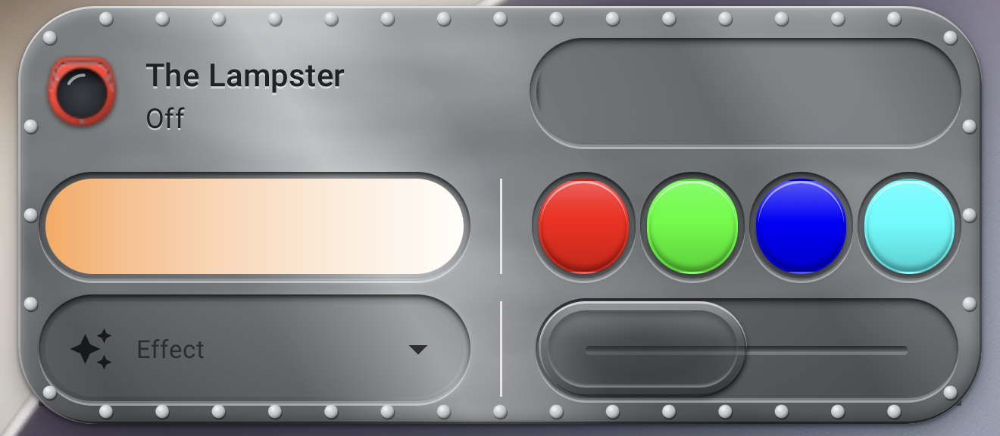

# The Lampster card

A dashboard card for [The Lampster](https://github.com/yamanote1138/lampster-ha-integration) RGB Bluetooth lamp in Home Assistant. It began as part of [GizmoGoody's fork](https://github.com/GizmoGoody/lampster-ha-integration) of that integration and moved here when the integration's maintainer chose to keep that repository focused on the integration.



The card needs the [The Lampster integration](https://github.com/yamanote1138/lampster-ha-integration), which provides the light it controls.

## Install

Home Assistant 2026.11 and later include the Marketplace, which replaces HACS. The card needs a Home Assistant version with the Marketplace, or HACS on an older one.

1. Go to **Settings** → **Marketplace**. On the first visit, select **I understand the risks and agree**.
2. In the upper-right corner, select **Add from link**, enter `GizmoGoody/lampster-card` under **GitHub link**, and select **Add**. If asked for the type, choose the dashboard type.
3. Open **The Lampster card** and select **Install**, then **Install** again in the dialog.
4. Reload the browser page (in the Companion app, pull down to refresh).

The Marketplace adds the card to **Settings** → **Dashboards** → **Resources** for you. To add the card, edit a dashboard, select **Add card**, and search for **The Lampster**.

Adding a repository from a link needs a connection to GitHub, which the Marketplace asks for the first time. With HACS on an older Home Assistant, use ⋮ → **Custom repositories**, add the same address with the type **Dashboard**, then select **Download**.

If you used the card that was built into the fork of the integration, remove its old resource at `/lampster/lampster-card.js` from **Settings** → **Dashboards** → **Resources** once you have installed this one.

The card is Home Assistant's tile card in a finish of your choice. Every tile card option works the same way and appears in the same editor: name, state content, tap and hold actions, and features such as the brightness slider. Below them, the **The Lampster style** panel sets the finish:

- **Collection** and **Style**: Metal (Polished Aluminum, Brushed Aluminum, Rusted Steel, or Painted in any color), Lampster Army, Lampster Artsy or Lampster Color. Collection **None** keeps your theme's own tile card and adds only the head, in a **Head color** of your choice, and the fasteners
- **Head color**: the head takes the style's color (Match style), or any color you choose, with every style
- **Randomize**: draws new reflections, rust, wear, splatter or sheen and keeps every other setting (every style except Brushed Aluminum)
- **Features style**: the slider and other features sit on the style itself (Match style), on a flat patch of the style's base color without rust, wear or splatter (Flat), or in a console, with channels pressed into the panel (Console). In a console, the brightness slider keeps its shape and its bar looks like a slatted roll-up door ending in a raised ridge, the color temperature slider's marker is a round loupe in a beveled bezel of the card's material, filled with the color it is on, the color favorites are keys that press in (the one matching the light stays pressed), and the toggle is a slide with a beveled tab. With Flat and Console, the style still shows between the color favorites
- **Fasteners**: Rivets, Phillips, Hex, Socket or None, matching the style or in any color
- **Fastener spacing**: Corners only, or fasteners all the way around at 1/2, 1/4, 1/8, 1/16, 1/32 or 1/64 spacing. Fasteners that would touch the head or the features are left out. For one fastener at each end of a single-row card instead of in its corners, add an E to the spacing in YAML (see below)
- **Color temperature**: on this card, the color temperature slider moves in steps of 100 K, and The Lampster follows it while it is dragged

The color pickers list the theme colors (such as Teal or Amber). For any other color, type it into the picker as a CSS color, such as `#1f6f78`, `rgb(31, 111, 120)` or a color name like `goldenrod`, and select **Custom color**.

The card's edge is drawn as a slightly raised panel. The tile card's Icon and Show entity picture options are left out of the editor, because the card shows the head there.

In place of the tile card's icon, the card shows The Lampster's head, with the light's current color in the lens.

```yaml
type: custom:lampster-card
entity: light.the_lampster
features:
  - type: light-brightness
# The Lampster style
style: rusted              # see the list below
head_color: match          # match (the style's color), a theme color such as amber, or any CSS color
pattern: 4242              # the reflections, rust, wear, splatter or sheen pattern
features_style: match      # match, flat or console
fasteners:
  type: rivets             # rivets, phillips, hex, socket or none
  color: match             # match, a theme color such as amber, or any CSS color
  spacing: 4               # 0 (corners), 2, 4, 8, 16, 32 or 64; add E (such as 4E) for ends on a single row
```

For Painted, `paint_color` sets the paint of the panel (and of the head, unless `head_color` gives it a color of its own). With None, `head_color` must be a color, because there is no style color to match.

| Option | Values | Default |
|--------|--------|---------|
| `style` | `none` (your theme's tile card), `polished`, `brushed`, `rusted`, `painted`, `army_black`, `army_blue`, `army_gold`, `army_green`, `army_red`, `army_white`, `artsy_black`, `artsy_gold`, `artsy_green`, `artsy_red`, `artsy_white`, `color_black`, `color_blue`, `color_gold`, `color_green`, `color_red` | `polished` |
| `paint_color` | For `painted`: the panel's paint, as a theme color such as `teal` or any CSS color such as `"#1f6f78"` | `teal` |
| `head_color` | The head's color: `match` (the style's color) or a theme or CSS color; with `none`, a color | `match`; `light-grey` for `none` |
| `pattern` | For the styles with something to randomize (all but `brushed` and `none`): any whole number; each number draws a different pattern | The default look |
| `features_style` | `match` (the style itself), `flat` (the style's base color only) or `console` (channels pressed into the panel); not used with `none` | `match` |
| `fasteners` | A group of three options: | |
| `  type` | `rivets`, `phillips`, `hex`, `socket` or `none` | `rivets` |
| `  color` | `match` (follows the style), a theme color such as `amber`, or any CSS color | `match` |
| `  spacing` | How many gaps each long edge is divided into: `0` (corners only), `2`, `4`, `8`, `16`, `32`, `64`. YAML only: add `E` (such as `4E`, or `0E` for ends only) to put one fastener at each end of a single-row card instead of in its corners. The visual editor shows the spacing without the E and keeps the E when you change the spacing there | `4` |

The editor writes every option the chosen style uses into the YAML, defaults included, and removes the ones it does not use (for example `pattern` and `features_style` when you switch to None). All other options are the [tile card's](https://www.home-assistant.io/dashboards/tile/). The tile card's `icon` and `show_entity_picture` options have no effect, because the head is shown there.

## Troubleshooting

### The card shows "Custom element does not exist"

- Check that **Settings** → **Dashboards** → **Resources** lists the card as a JavaScript module. The Marketplace adds it when you install the card.
- Reload the browser page once. A dashboard opened before the card was available can keep showing the error until then.
- If your dashboard resources are defined in YAML (`lovelace:` `resource_mode: yaml`), the Marketplace cannot add the resource. Its install dialog shows the resource to add. The older address below also still works:

```yaml
lovelace:
  resources:
    - url: /hacsfiles/lampster-card/lampster-card.js
      type: module
```

## Development

The card is tested by the pages in `tests/card/`, which load the card with stand-ins for the Home Assistant frontend and check how it draws (styles, fasteners, features styles, the editor). They run on GitHub for every push too. To run them locally with Chrome, Chromium or Edge:

```bash
python tests/card/run_card_tests.py
```

To look at the cards, open a page such as `tests/card/features.html` in the browser.

## License

MIT, see [LICENSE](LICENSE).
